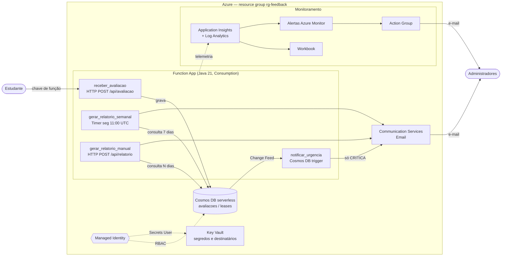
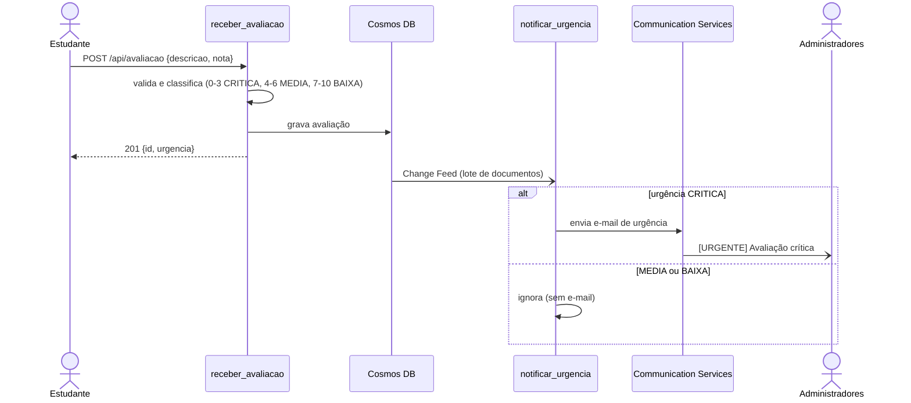
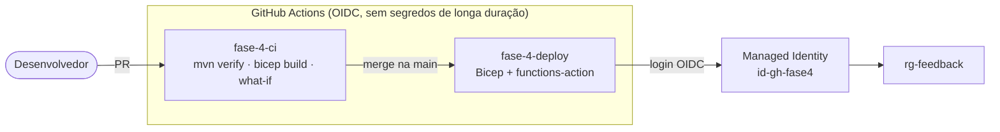

# Arquitetura — Plataforma de Feedback de Aulas

Diagrama dos componentes e dos fluxos de dados. O texto de cada componente está na seção 2 do [README](../README.md).

## Visão geral

## Fluxo de uma avaliação crítica

## CI/CD

